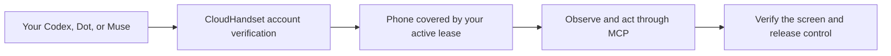

# CloudHandset MCP Plugins

**Give your AI agent a real Android phone.**

Connect your own Codex, OpenAI Dot, or Meta Muse to the physical Android phones covered by your CloudHandset leases. Your agent can inspect the screen, perform the task you request, verify the visible result, and release control when finished.

[CloudHandset website](https://www.cloudhandset.com) · [Codex installation](CODEX_INSTALL.md) · [Dot installation](DOT_INSTALL.md) · [Muse installation](MUSE_INSTALL.md) · [Releases](https://github.com/ziyouzhilong/cloudhandset-mcp/releases) · [Changelog](CHANGELOG.md) · [Support](SUPPORT.md)

**Required model for Codex and Dot phone operation:** Select **GPT-6.1 Sol or a more capable model** before asking Codex or Dot to operate the phone. This requirement applies to phone operation, not plugin installation. Muse uses its host-provided model; this kit does not select or replace that model.

## Download

| Client | Current package | Get started |
| --- | --- | --- |
| Codex | [CloudHandset for Codex 0.1.3](https://github.com/ziyouzhilong/cloudhandset-mcp/releases/download/plugins-2026.10.11/cloudhandset-codex-plugin-0.1.3.zip) | [Installation guide](CODEX_INSTALL.md) |
| OpenAI Dot | [CloudHandset for Dot 0.2.4](https://github.com/ziyouzhilong/cloudhandset-mcp/releases/download/plugins-2026.10.18/cloudhandset-dot-setup-0.2.4.zip) | [Installation and upgrade](DOT_INSTALL.md) · [File upload](DOT_UPLOAD.md) · [First screen check](DOT_SETUP.md) |
| Meta Muse | [CloudHandset for Muse 0.1.2](https://github.com/ziyouzhilong/cloudhandset-mcp/releases/download/plugins-2026.10.18/cloudhandset-muse-setup-0.1.2.zip) | [Installation guide](MUSE_INSTALL.md) · [Parallel control](PARALLEL_CONTROL.md) |

Download the ZIP for your client. For Codex and Dot, upload it to a Codex conversation in Work mode for setup assistance, or extract it and follow the manual guide. For Muse, follow its dedicated setup guide. Verify the original downloads with [SHA256SUMS](SHA256SUMS). Codex 0.1.3 keeps its original release and checksum; the new Dot and Muse assets are in the [2026-10-18 release](https://github.com/ziyouzhilong/cloudhandset-mcp/releases/tag/plugins-2026.10.18). GitHub's automatically generated **Source code** archives contain repository files; choose the named setup ZIP for your client.

These public packages contain no login credentials or pre-bound customer connection. Every customer signs in with their own CloudHandset account. The Dot ZIP is a setup kit: create your account connection, bind its technical ID, and generate the smaller archive to upload to ChatGPT Plugins.

## Connection flow



## What your agent can do

| Capability | How it is used |
| --- | --- |
| Find your phones | List the Android phones available through the authenticated connection. |
| Inspect the screen | Receive a current screenshot and use its actual image coordinates. |
| Operate Android apps | Tap, swipe, scroll, enter text, and send supported key or gesture inputs. |
| Verify progress | Obtain a fresh screenshot after an action and check its visible result. |
| Resolve an uncertain action | Check the original operation and observe its result before continuing. |
| Finish cleanly | Release held inputs and confirm that phone control has closed and drained. |

Phone control follows the task you give the agent and the approvals required by its host. The agent should not interrupt another operator. CloudHandset MCP does not provide audio or an arbitrary shell tool.

## Before you install

- A CloudHandset account with an active lease for a provisioned Android phone.
- A supported client that can use MCP tools and inspect the images returned by them.
- **Codex:** a version with plugin support. Package installation was checked with Codex CLI `0.162.0-alpha.2`; the guide also includes a manual MCP connection route.
- **Dot:** an account with **Create custom MCP server** and **Upload plugin archive**, plus Python 3.9 or later to bind and package your copy. On Windows, use `py -3` in place of `python3`.
- **Muse:** access to Custom Connectors and Muse's execution environment with its official credential helper. A real connection and screen check passed in one Muse account on 2026-10-10.

Nothing from these packages needs to be installed on the Android phone. The connection becomes useful after you complete your own account verification and first screen check.

## Install for Codex

In a Codex conversation in **Work mode**, upload the plugin ZIP and ask Codex to install it for you. Complete your own CloudHandset login in the separate verification window when prompted.

### Manual installation

Extract `cloudhandset-codex-plugin-0.1.3.zip`, open a terminal in the extracted `cloudhandset-codex/` folder, and run:

```sh
codex plugin marketplace add .
codex plugin add cloudhandset@cloudhandset
codex plugin list
codex mcp get cloudhandset
codex mcp login cloudhandset
```

If installation already completed verification, another login is unnecessary. Keep an existing working CloudHandset connection and check conflicts before changing it; do not create duplicate MCP servers. Keep the extracted plugin folder available, then open a new Codex conversation.

Start with:

> Use $cloudhandset-phone to list my Android phones, let me choose one if needed, inspect its current screen, and release control. This is a screen check only; do not tap or type.

See the [Codex installation guide](CODEX_INSTALL.md) for the manual alternative, login expiry, troubleshooting, and removal.

Existing Codex users: follow [the upgrade steps](CODEX_INSTALL.md#upgrade-an-existing-installation) to replace the local marketplace source while retaining OAuth. Confirm version 0.1.3 and start a new conversation.

## Install for Dot

**Upgrading an earlier Dot version?** Keep the working CloudHandset connection, refresh its MCP tools, and bind the extracted 0.2.4 kit to the same technical app ID. Generate the archive using steps 3–4 below, then choose **More → Upload new version** on your existing plugin. Verify version 0.2.4, one connected app, and one android-phone skill. See [upgrade instructions](DOT_INSTALL.md#upgrade-from-an-earlier-version) and the [file-upload reference](DOT_UPLOAD.md).

Alternatively, upload the entire setup ZIP to a Codex conversation in **Work mode** and ask Codex to help you install it. You still need to complete your own account verification; the full setup ZIP is a chat attachment for setup assistance, not the archive to import through ChatGPT Plugins.

### Manual installation

1. Open [ChatGPT Plugins](https://chatgpt.com/plugins) and choose **Add → Create custom MCP server**.
2. Enter the settings below, then complete **Verify and connect** in the separate CloudHandset verification window.
3. Extract the Dot setup ZIP. In `cloudhandset-dot/`, run `python3 bind-connection.py YOUR_CONNECTION_TECHNICAL_ID` using the real `asdk_app_…` or `plugin_asdk_app_…` ID from your newly created connection.
4. In the extracted `plugin/` folder, run `python3 -m zipfile -c ../cloudhandset-dot-connected.zip plugin.json .app.json skills`.
5. In ChatGPT Plugins, choose **Add → Upload plugin archive**, upload the generated `cloudhandset-dot-connected.zip`, and install/enable it for the account used by Dot.

| Connection setting | Value |
| --- | --- |
| Server URL | `https://device.cloudhandset.com/mcp` |
| Authentication | OAuth |
| Registration method | Custom OAuth client / pre-registered client |
| OAuth client ID | `cloudhandset-dot` |
| OAuth client secret | Leave empty |
| Token endpoint authentication method | `none` |
| Scope | `device:control` |
| Expected callback URL | `https://chatgpt.com/connector_platform_oauth_redirect` |

Use these settings only when the displayed callback matches exactly. The client ID is a public application identifier. If your account lacks the required options or displays another callback, contact CloudHandset support through the [website](https://www.cloudhandset.com).

The installed plugin should show **one connected CloudHandset app** and **one android-phone skill**. Do not upload the full setup ZIP. Keep your generated, account-bound archive private; distribute only the original unbound download.

Start with the [Dot screen-check prompt](DOT_SETUP.md). The [complete Dot installation guide](DOT_INSTALL.md) also explains the optional local Codex route, which requires an online computer connected to Dot.

## Set up Meta Muse

CloudHandset for **Meta Muse 0.1.2** uses Muse's Custom Connector and official credential helper. Download the ZIP, attach its six files (`README.md`, `SETUP.md`, `TOOLS.md`, `PARALLEL_CONTROL.md`, `cloudhandset.py`, `upload_file.py`) to a Muse conversation, and follow the [installation and upgrade guide](MUSE_INSTALL.md). Muse installs both scripts side by side; you complete your own CloudHandset login if needed. An existing valid connector can be retained when upgrading.

## Parallel phone work

Dot 0.2.4 and Muse 0.1.2 keep a separate session, observation, operation history, result, and release record for each Android phone. Different phones can progress in parallel; steps on the same phone remain ordered. Busy phones stay with their current operator. Give the agent the selected phone names and the task for each phone.

The service permits **at most 16 simultaneously controlled Android phones per account**, shared across all clients, connections, credentials, and tasks. You can own or list more phones. Capacity becomes available only after a session is confirmed closed and drained. A larger worker setting, another connection, or another agent does not increase this limit. Use one coordinator to share rate limits and reserve capacity for release. See [parallel-control instructions](PARALLEL_CONTROL.md).

Dot uses its host's native parallel tools when available; otherwise it must report interleaved execution. Muse provides an explicitly bounded and paced `parallel` command. Neither client retries uncertain phone actions automatically. Report the outcome and cleanup separately for every phone, including partial failures.

## Validation scope — 2026-10-18

Service capacity was checked at 1, 4, 8, and 16 phones for 120 seconds per level. Dot 0.2.4 was installed in the existing cloud plugin; Codex exercised its existing authenticated Dot connection with two concurrent phone sessions, separate screen checks, Settings/Home actions, and closed/drained release. Muse's own host exercised two phones in parallel, explicit normalized-coordinate taps, clipboard write/read, and two consecutive 4,694,656-byte Demo MP4 uploads on one phone, reported at 28 seconds each. Both uploads completed with the active-session check passed, both videos were inspected in Gallery, and both phone sessions were closed and drained. These were two-phone client checks, not native 16-phone app-workflow tests. Upload recovery after an unknown result was not triggered. Some navigation-bar taps on one Muse test phone produced no visible change despite acceptance; an in-app back tap worked. That isolated behavior remains unexplained.

## Fast file upload

All three versions include the same uploader. The agent reads your attached/local file, requests a file-specific upload through its authenticated connection, and sends one binary transfer. CloudHandset uses its original upload writer to deliver the file to the Android phone. The limit is 30 MiB. The agent checks final completion and releases control; it checks the intended media picker when your task needs it. See [the upload guide](DOT_UPLOAD.md).

A 4,694,656-byte Demo MP4 completed upload, checksum and media-index checks in the 2026-10-11 acceptance run: web 41.829 s, Codex 23.447 s, Dot connection exercised by Codex 24.128 s, and Muse's own host 25.567 s. This was one run on one Android phone, not a speed guarantee or a test of Dot autonomously publishing content.

## How account access works

The MCP endpoint is `https://device.cloudhandset.com/mcp`. Your client opens an independent English verification window for your CloudHandset login. Enter your credentials there, not in an agent conversation. Choose **Current and future Android phone leases** to include eligible phones added during this fixed authorization, or **Only one selected Android phone** for access to one phone. Existing single-phone connections do not expand automatically: reconnect once to opt in, then refresh the tools and call `list_devices` again. Each phone still requires an effective lease; account scope does not clear an explicit automation stop.

Authorization lasts **up to 30 days**. Each phone requires an effective lease; single-phone access ends no later than that lease. When it expires, complete a new verification flow before continuing. Reauthentication cannot extend a phone lease. There is no separate Agent/MCP authorization page in the CloudHandset website console.

Each phone has one active controller. When a person takes control back through CloudHandset, the agent must stop. Take-back preserves valid authorization. Leaving the control page, backgrounding or closing it, or disconnecting releases the customer's session. Once it is closed and the short handover window has passed, an already authorized task can acquire a new Agent session with the same connection, without another login. The agent must inspect a fresh screenshot and must not replay interrupted actions. At the end of a task, the agent should confirm that its control session is closed and drained.

## FAQ

### Is this a public plugin marketplace listing?

This repository provides downloadable installation packages. Codex uses the included local plugin marketplace. Dot customers create their own MCP connection and upload their own bound skill archive. Muse uses a Custom Connector and execution adapter; it is not a Meta-approved directory listing. There is no one-click public marketplace installation in these releases.

### Does installing the package connect a phone automatically?

You must authenticate your own CloudHandset account and have an eligible phone lease. Installing a skill alone does not grant phone access. Run the first screen check after setup to confirm that the agent can inspect an actual image and release control.

### Can new phones use the same setup?

Existing and newly provisioned phones use the same client setup. A phone must finish provisioning and have an effective lease before it is eligible. With account-scope authorization, call `list_devices` again to discover them. Existing single-phone connections require a one-time reconnect to opt in.

### Does my computer need to stay online?

Codex needs its executing computer to remain available. Dot's direct cloud connection does not require your personal computer to stay online. The optional Dot-to-local-Codex route does. Muse's adapter runs in Muse's execution environment; availability and background behavior depend on that host. None of these packages installs an always-on task runner or guarantees indefinite or scheduled background execution.

### Why does Codex return to a localhost address after login?

Codex can receive its OAuth callback at `127.0.0.1` on your computer. The phone-control service still uses the public HTTPS MCP endpoint. Never share a complete callback URL, token, password, or verification code in chat.

### What if an action times out or the phone is busy?

Do not take over a busy phone. For a timed-out action, preserve its original operation ID, check its status, and inspect the associated screen. Do not repeat an action whose outcome is unknown. The included skills guide the agent through these cases and report unresolved cleanup.

### Does uninstalling a plugin revoke access?

Removing a skill, disconnecting an app, and revoking a CloudHandset authorization are separate actions. Release phone control before disconnecting. Codex logout removes local credentials; it does not revoke the server-side grant. For immediate server-side revocation, contact CloudHandset support through the [website](https://www.cloudhandset.com).

### Where can I get help?

Start with the installation guide for your client. For account, lease, connection, or revocation assistance, use [CloudHandset](https://www.cloudhandset.com). Include the client version and a redacted error message; keep credentials and private phone screenshots out of public reports.

## Package contents

| File or folder | Purpose |
| --- | --- |
| Codex setup ZIP | Local plugin marketplace, MCP configuration, phone-operation skill, and installation guide. |
| Dot setup ZIP | Connection-binding script, unbound Dot skill, installation and first-use guides, and the optional Codex dependency. |
| Muse setup ZIP | Custom Connector setup prompts, tool reference, and credential-free Python MCP adapter. |
| [CODEX_INSTALL.md](CODEX_INSTALL.md) | Complete Codex setup and account-access guidance. |
| [DOT_INSTALL.md](DOT_INSTALL.md) | Complete Dot OAuth, per-account binding, and archive-upload instructions. |
| [DOT_SETUP.md](DOT_SETUP.md) | First-use prompts and control/recovery behavior. |
| [muse/README.md](muse/README.md) | Muse compatibility, setup, and current validation status. |
| [SHA256SUMS](SHA256SUMS) | Checksums for the downloadable packages. |

This repository distributes client setup packages and documentation for the CloudHandset service.
